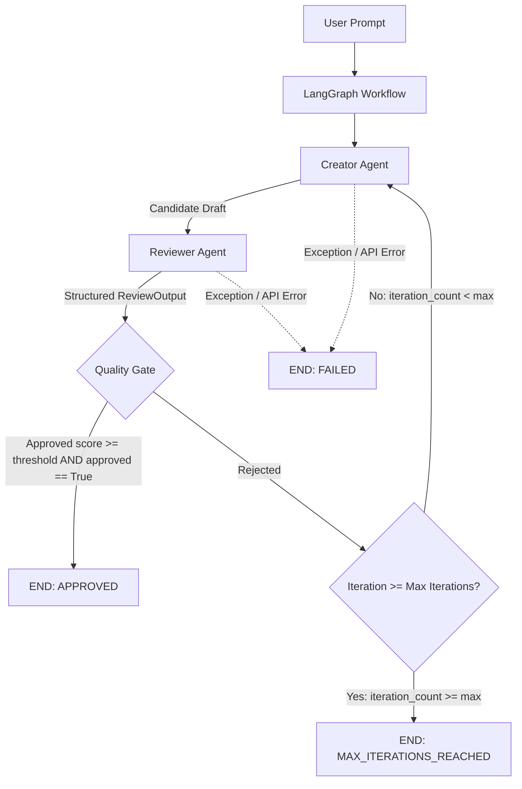

HEAD
# CritiqLoop AI — Agentic AI Feedback Loop

**CritiqLoop AI** is an agentic feedback-loop system built using **LangGraph**, **LangChain**, and **Groq**. A **Creator Agent** generates candidate content, a **Reviewer Agent** evaluates it across four structured metrics, and the system iteratively refines the draft until it satisfies a deterministic application-level quality gate or reaches a maximum iteration limit.

---

## ✨ Features

- **Creator Agent**: Produces initial drafts and feedback-driven refinements using dual prompt modes.
- **Reviewer Agent**: Evaluates content independently across 4 required metrics (`relevance`, `clarity`, `completeness`, `overall_quality`) using structured Pydantic output.
- **LangGraph State Graph**: Manages state transitions, cycle iteration counters, and state-driven conditional routing.
- **Iterative Refinement**: Passes previous draft, strengths, weaknesses, and actionable feedback to the Creator without overwriting initial goal context.
- **Deterministic Quality Gate**: Enforces dual-condition programmatic approval: `overall_quality >= threshold AND review.approved is True`.
- **Maximum Iteration Protection**: Caps iteration cycles (default: 3) to prevent infinite loops.
- **Graceful Error Handling & Resilience**: Redacts API keys (`gsk_...`) and translates technical exceptions into user-friendly CLI error messages.
- **Rich CLI Observability**: Displays iteration audit tables, quality gate decision panels, and final execution summaries.
- **Automated Test Suite**: 23 mock-isolated unit and workflow tests requiring zero live Groq API calls.

---

## 🏗️ Architecture Diagram



---

## 🔄 The Agentic Feedback Loop Explained

CritiqLoop AI qualifies as an **Agentic AI Feedback Loop** because it operates autonomously towards a user-defined goal through continuous evaluation and refinement:

```
User Prompt
    │
    ▼
Creator Agent ─── (Draft 1) ───► Reviewer Agent ─── (ReviewOutput) ───► Quality Gate
    ▲                                                                         │
    │                                                                         ├─ Approved ──► END (APPROVED)
    └───────────────────── (Feedback Delta) ──────────────────────────────────┼─ Rejected ──► Refinement Loop
                                                                              └─ Max Iter ──► END (MAX_ITERATIONS)
```

1. **Goal-Directed Generation**: The Creator receives the prompt and generates an initial candidate response.
2. **Independent Critique**: The Reviewer evaluates the draft against strict evaluation criteria.
3. **Programmatic Decision**: The application enforces a deterministic quality gate on the review scores.
4. **State-Based Iterative Refinement**: If rejected and iterations remain, the feedback delta (strengths, weaknesses, actionable guidance) is passed to the Creator to produce a revised draft.

> **Note**: This system performs goal-directed generation, critique, feedback propagation, and state graph routing. It does not update LLM model weights.

---

## 📊 State Graph & State Transitions

The application state is encapsulated in `AgentState` (`src/state.py`):

| State Field | Type | Description |
| :--- | :--- | :--- |
| `task_prompt` | `str` | Original user goal prompt (immutable context). |
| `current_draft` | `str` | Most recent content draft produced by the Creator. |
| `latest_review` | `Optional[ReviewOutput]` | Complete structured evaluation from the latest Reviewer run. |
| `history` | `List[IterationHistoryEntry]` | Monotonically accumulating list of iteration records. |
| `iteration_count` | `int` | Current 1-indexed iteration counter (starts at 1). |
| `max_iterations` | `int` | Upper limit boundary cap (default: 3). |
| `quality_threshold` | `int` | Required numeric overall quality score out of 10 (default: 8). |
| `status` | `str` | Operational status: `IN_PROGRESS`, `APPROVED`, `MAX_ITERATIONS_REACHED`, `FAILED`. |
| `error_message` | `Optional[str]` | Sanitized diagnostic error string if an error occurs. |

### State Transition Diagram

```
       START
         │
         ▼
     [CREATOR]
         │
         ▼
    [REVIEWER]
         │
         ▼
   {QUALITY GATE}
     ├── APPROVED ────────────────────────────► [END] (Status: APPROVED)
     ├── FAILED ──────────────────────────────► [END] (Status: FAILED)
     └── REJECTED
            │
            ▼
    Is iteration_count < max_iterations?
            ├── YES ──────────────────────────► [CREATOR] (Refinement mode)
            └── NO ───────────────────────────► [END] (Status: MAX_ITERATIONS_REACHED)
```

---

## 🎯 Deterministic Quality Gate

Approval is strictly governed by application code in `src/graph/workflow.py`:

```python
is_approved = (review.overall_quality >= quality_threshold) and (review.approved is True)
```

### Approval Rules

1. **Numeric Quality Requirement**: `review.overall_quality` must be $\ge$ `quality_threshold` (e.g. 8/10).
2. **Boolean Reviewer Flag**: `review.approved` must be `True`.
3. **Dual Condition**: Both conditions must be satisfied. A high score cannot bypass `approved=False`, and an LLM `approved=True` cannot bypass a score below the threshold.

---

## ⏱️ Bounded Iteration Control

To prevent unbounded loops or API credit exhaustion, CritiqLoop AI enforces strict iteration bounds:

* **Default Limit**: `MAX_ITERATIONS = 3`
* **Execution Trace**:
  - **Iteration 1**: Initial Generation $\rightarrow$ Review $\rightarrow$ Decision
  - **Iteration 2**: Refinement $\rightarrow$ Review $\rightarrow$ Decision
  - **Iteration 3**: Refinement $\rightarrow$ Review $\rightarrow$ Decision $\rightarrow$ **STOP (`MAX_ITERATIONS_REACHED`)**

There is **never** an Iteration 4. Bounded loops ensure predictable latency, cost control, and reliable termination.

---

## 🛡️ Error Handling & Security

CritiqLoop AI includes robust exception handling for API and runtime failures:

* **Supported Scenarios**: Missing API keys, 401 Authentication errors, 404 Model not found, 429 Rate limits, Network timeouts, and Structured Pydantic parsing failures.
* **Secret Redaction**: Error messages are processed through `sanitize_error_message()` in `src/utils/errors.py` to strip Groq API keys (`gsk_...`) and Bearer tokens before reaching logs or the CLI.
* **Failure Routing**: Errors transition state to `status = "FAILED"`, and the graph terminates immediately at `END` without retrying the Creator or risking unhandled stack traces.

---

## 💻 Installation & Setup

### Windows PowerShell Setup

```powershell
# 1. Clone the repository
git clone https://github.com/your-username/CritiqLoop-AI.git
cd CritiqLoop-AI

# 2. Create a virtual environment
python -m venv .venv

# 3. Activate the virtual environment
.\.venv\Scripts\Activate.ps1

# 4. Install project dependencies
pip install -r requirements.txt

# 5. Configure environment variables
Copy-Item .env.example .env
```

Edit `.env` to set your Groq API key:
```env
GROQ_API_KEY=gsk_your_actual_groq_api_key_here
GROQ_MODEL=llama-3.3-70b-versatile
MAX_ITERATIONS=3
QUALITY_THRESHOLD=8
```

---

## 🚀 Running the Application

### Default Goal Prompt Run
```bash
python main.py
```

### Custom Goal Prompt Run
```bash
python main.py "Explain the architectural principles of Agentic AI loops and state graphs for software engineers."
```

### Expected Output
1. Workflow configuration summary.
2. Step-by-step graph execution indicators.
3. Rich table iteration audit trail (Scores, Strengths, Weaknesses, Feedback).
4. Explicit Quality Gate decision breakdown.
5. Final execution summary panel and final draft output.

---

## 🧪 Running Automated Tests

Run the complete test suite locally without requiring a live Groq API key:

```bash
pytest -q -p no:langsmith
```

All 23 unit and integration tests use deterministic mocks (`unittest.mock.MagicMock`) for fast, offline, repeatable validation.

---

## 🌐 Web UI & API Architecture

CritiqLoop AI includes a modern Web UI dashboard powered by a FastAPI backend wrapper over the core LangGraph state graph.

```
React UI (TypeScript + Tailwind CSS)
    │
    │  POST /api/run
    ▼
FastAPI Backend (src/api/main.py)
    │
    │  invokes build_workflow()
    ▼
LangGraph State Graph Engine
    │
    ├── Creator Agent (Generation & Refinement)
    ├── Reviewer Agent (Structured Evaluation)
    └── Programmatic Quality Gate
    │
    ▼
Structured API JSON Response (RunResponse)
```

### Starting the Web Application

#### 1. Start FastAPI Backend Server
```bash
uvicorn src.api.main:app --reload --port 8000
```
- Health Check: `http://localhost:8000/api/health`
- OpenAPI Documentation: `http://localhost:8000/docs`

#### 2. Start React Dev Dashboard
```bash
cd frontend
npm install
npm run dev
```
- Open browser at: `http://localhost:5173`

---

## 📂 Project Structure

```
CritiqLoop-AI/
├── main.py                    # CLI application entrypoint & Rich observability
├── PROJECT_SPEC.md            # Technical design specification
├── README.md                  # Project documentation & architecture guide
├── requirements.txt           # Project dependencies including FastAPI & Uvicorn
├── .env.example               # Template environment configuration
├── .gitignore                 # Git ignore rules
│
├── src/
│   ├── api/                   # FastAPI Web Backend
│   │   ├── main.py            # API routes (/api/health, /api/run) & CORS middleware
│   │   └── schemas.py         # Request/Response Pydantic schemas
│   │
│   ├── state.py               # Central AgentState TypedDict schema
│   ├── schemas.py             # Pydantic schemas (ReviewOutput, IterationHistoryEntry)
│   │
│   ├── agents/
│   │   ├── creator.py         # Creator Agent (Initial generation & refinement)
│   │   └── reviewer.py        # Reviewer Agent (Structured evaluation)
│   │
│   ├── graph/
│   │   └── workflow.py        # LangGraph nodes, state graph assembly, routing logic
│   │
│   └── utils/
│       ├── __init__.py
│       └── errors.py          # Secret sanitization & error diagnostic utilities
│
├── frontend/                  # React + TypeScript + Vite + Tailwind CSS Web Dashboard
│   ├── src/
│   │   ├── components/        # ScoreCards, QualityGate, Timeline, FinalDraft, ErrorPanel
│   │   ├── services/          # API fetch client
│   │   ├── types/             # TypeScript API interfaces
│   │   ├── App.tsx            # Main dashboard layout
│   │   └── main.tsx
│   ├── index.html
│   ├── vite.config.ts
│   └── package.json
│
└── tests/
    ├── test_agents.py         # Unit tests for Creator & Reviewer agents
    ├── test_workflow.py       # Integration tests for graph workflow & quality gate
    ├── test_state.py          # Unit tests for state schemas
    ├── test_errors.py         # Unit tests for error handling & FAILED routing
    └── test_api.py            # FastAPI endpoint integration tests
```

---

## 🛠️ Technology Stack

- **Python 3.11+**: Primary language environment.
- **LangGraph**: State graph orchestration, conditional edge routing, state persistence.
- **LangChain & langchain-groq**: Groq LLM integration and message abstraction.
- **Groq API**: Fast LLM inference host.
- **Pydantic v2**: Strict schema validation for structured Reviewer outputs.
- **Rich**: Terminal output formatting, score tables, and status panels.
- **Pytest**: Mock-isolated automated test suite.

---

## 🔒 Security Notes

- **Credentials Safety**: API keys are loaded exclusively from `.env` and are never hardcoded.
- **Git Protection**: `.env` is listed in `.gitignore` to prevent accidental secret commits.
- **Sanitized Diagnostics**: Runtime errors pass through regex sanitization to strip keys and tokens.
- **Isolated Tests**: Automated tests use mocks and do not perform network calls or leak credentials.

---

## 📝 Illustrative Execution Example

*(Representative walk-through demonstrating state-based refinement)*

```
Iteration 1 Summary
├── Relevance: 8/10 | Clarity: 7/10 | Completeness: 6/10 | Overall Quality: 7/10
├── Strengths: ✓ Good architectural structure
├── Weaknesses: ✗ Missing concrete Python code examples
└── Actionable Feedback: Add code snippets demonstrating LangGraph StateGraph initialization.

Quality Gate Decision: FAIL (7/10 score < 8/10 threshold) -> Route to Creator (Iteration 2)

Iteration 2 Summary
├── Relevance: 9/10 | Clarity: 9/10 | Completeness: 9/10 | Overall Quality: 9/10
├── Strengths: ✓ Excellent code snippets and clear section organization
├── Weaknesses: None
└── Actionable Feedback: Content is complete and clear.

Quality Gate Decision: PASS (9/10 score >= 8/10 threshold AND approved == True) -> Route to END
Final Status: APPROVED (2 iterations used)
```

---

## 🎭 Final Demo Flow

A 3–5 minute presentation sequence demonstrating CritiqLoop AI:

1. **Introduction**: Explain CritiqLoop AI as a dual-agent feedback system governed by a LangGraph state graph.
2. **Task Goal Submission**: Enter a prompt (e.g. *"Explain the architectural principles of Agentic AI loops and state graphs for software engineers"*).
3. **Configuration Setup**: Highlight the Max Iterations cap (e.g. 3 cycles) and Quality Score Threshold (e.g. 8/10).
4. **Execution**: Click **Run CritiqLoop AI**. Point out the execution indicator (`Executing Loop...`).
5. **Dual-Agent Interaction**:
   - **Creator Agent** generates candidate text (Initial Mode).
   - **Reviewer Agent** critiques the draft independently across 4 structured metrics.
6. **Quality Gate Evaluation**: Show the Quality Gate decision panel evaluating both independent conditions:
   $$\text{Overall Quality} \ge 8/10 \quad \text{AND} \quad \text{Reviewer Approved} == \text{True}$$
7. **Iterative Refinement**:
   - If rejected, point out how the Creator receives previous draft + strengths + weaknesses + actionable guidance to produce an improved draft.
8. **Audit Timeline**: Walk through Iteration 1 vs. Iteration 2 in the expandable timeline.
9. **Final Output**: Showcase the rendered Markdown output in the **Final Approved Draft** panel.
10. **Resilience & Bounds**: Demonstrate that the workflow stops after max 3 iterations if unapproved, or terminates safely with sanitized diagnostics if network/API issues occur.

=======
# CritiqLoop-AI
e779455603fbc5216d66712b0747ec9c610db30d
